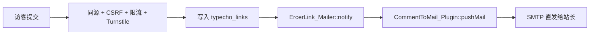

<div align="center">

<a id="top"></a>

# 🔗 ErcerLink

**handsome 快速申请友链插件 · 安全重写版**

[](https://github.com/OuOumm/ErcerLink/releases)
[](https://www.php.net/)
[](https://github.com/typecho/typecho)
[](#features)
[](#testing)
[](#license)

**前台提交 → 多层校验 → 写入友链 → 邮件通知站长**

原作 [二C](https://blog.ccdalao.cn/archives/197/) · [文档](#toc) · [下载](https://github.com/OuOumm/ErcerLink/releases) · [反馈](https://github.com/OuOumm/ErcerLink/issues)

</div>

---

> [!IMPORTANT]
> **v1.4.0 是一次安全重写**，修复了存储型 XSS、CSRF 防护失效、CDN 地址注入等问题；**v1.5.0 起邮件通知只支持 [CommentToMail](https://github.com/OuOumm/CommentToMail) 6.0+**，旧版队列通道已移除。升级请直接覆盖目录，再在后台停用并重新启用一次以刷新路由。

<a id="toc"></a>

## 📑 目录

- [✨ 特性](#features)
- [🚀 快速开始](#quickstart)
- [⚙️ 配置项](#config)
- [🧩 使用教程](#usage)
- [📧 邮件通知](#mail)
- [📦 依赖与环境](#deps)
- [📸 效果图](#screenshot)
- [🧪 测试](#testing)
- [📜 更新日志](#changelog)
- [🙏 致谢](#credits) · [📄 许可](#license)

---

<a id="features"></a>

## ✨ 特性

| | |
|---|---|
| 🚀 **前台直提** | 访客在友链页直接提交，无需进后台 |
| 🔒 **多层防护** | 同源校验 + 双提交 Cookie CSRF + 频率限制 + 可选 Turnstile |
| 🛡️ **输入规范化** | 链接只接受 HTTP(S)，文本剥离全部标签与危险字符，URL 归一化后查重 |
| 📧 **邮件通知** | 经 CommentToMail 6.0+ SMTP 直发，正文自渲染，不复用评论模板 |
| ⚡ **PJAX 友好** | `pjax_Link()` 幂等可重复调用，也可 `ErcerLink.refresh()` 强制重建 |
| 🧩 **零 jQuery** | 纯原生 JS + `fetch`，任何主题都能渲染 |
| 📱 **自适应** | 响应式表单，跟随站点暗色主题 |
| 🔐 **无密钥外泄** | 前端配置不含 Turnstile Secret，JSON 以 `JSON_HEX_TAG` 输出 |

---

<a id="quickstart"></a>

## 🚀 快速开始

**目标环境**：Typecho 1.1+ · PHP 5.6+ · 任意主题（不需要 jQuery）

1. 下载 [最新 Release](https://github.com/OuOumm/ErcerLink/releases) 或从仓库打包，将目录重命名为 `ErcerLink`：

   ```text
   ErcerLink/
   ├── Plugin.php        # 生命周期、配置表单、前端脚本注入
   ├── Action.php        # /link_add 路由：校验 → 写库 → 触发通知
   ├── Mailer.php        # 邮件通知与正文渲染
   ├── Util.php          # CSRF / 同源 / 限流 / 清洗 / URL 规范化 / IP
   ├── js/ErcerLinks.js  # 前端表单，原生 JS
   ├── README.md
   └── tests/            # CLI 验证脚本，不参与运行时
   ```

2. 上传到 Typecho 插件目录 `usr/plugins/`。
3. 后台 **「控制台 → 插件」** 启用 **ErcerLink**，按需填写配置。

> [!TIP]
> **升级安装**：直接覆盖 `ErcerLink/` 目录，然后停用再启用一次即可刷新路由。原有配置（CDN 地址、Turnstile 密钥、邮件通知开关）全部兼容，无需重填。

> [!WARNING]
> 邮件通知要求已启用 **CommentToMail 6.0 及以上**。未安装或版本过低时，开启该项会被配置校验直接拦下；不影响友链提交本身。

---

<a id="config"></a>

## ⚙️ 配置项

<details open>
<summary><strong>资源加载</strong></summary>

| 字段 | 默认值 | 说明 |
|---|---|---|
| `path`（CDN 加速地址） | 空 | 留空用插件自带脚本；填写时必须是**以 `.js` 结尾的 HTTP(S) 地址**，`javascript:` / `data:` 等伪协议与非法后缀一律拒绝 |

</details>

<details open>
<summary><strong>安全设置</strong></summary>

| 字段 | 默认值 | 说明 |
|---|---|---|
| `turnstileSiteKey` | 空 | Cloudflare Turnstile 前端站点密钥 |
| `turnstileSecretKey` | 空 | 后端验证密钥，**留空即关闭验证码** |
| `proxyHeader`（客户端 IP 来源） | `NONE` | 默认只信任 `REMOTE_ADDR`；挂在 CDN / 反代后可选 `CF-CONNECTING-IP`、`X-FORWARDED-FOR`、`X-REAL-IP`，否则所有访客会共享同一个限流计数 |

</details>

<details open>
<summary><strong>通知设置</strong></summary>

| 字段 | 默认值 | 说明 |
|---|---|---|
| `enableEmailNotify` | `0`（关闭） | 开启后，新友链提交会立即通知站长 |

开启后调用 `CommentToMail_Plugin::pushMail()`，SMTP 与异步策略全部沿用 CommentToMail 自身的配置，本插件不重复保存一份。

</details>

---

<a id="usage"></a>

## 🧩 使用教程

### 1. 放置挂载点

在友链页面任意位置添加：

```html
<div id="postLink"></div>
```

### 2. PJAX 支持

```javascript
pjax_Link();
```

`pjax_Link()` 幂等，重复调用不会重复渲染或重复绑定；需要强制重建时用 `ErcerLink.refresh()`。

### 3. 启用 Turnstile 验证码（可选）

1. 在 [Cloudflare Dashboard](https://dash.cloudflare.com/) 创建 Turnstile 部件，拿到 Site Key 与 Secret Key；
2. 在插件配置中填入两个密钥；
3. 保存即生效，留空则不启用。

前端以 `render=explicit` 渲染，`action` 固定为 `link_add`，服务端同时校验 `success`、`action` 与 `hostname`。

---

<a id="mail"></a>

## 📧 邮件通知



- **版本门禁**：`ErcerLink_Mailer::available()` 要求依赖已启用且提供 `pushMail()`；不满足时配置表单拦下、运行期静默跳过，不会再去写新版已删除的 `typecho_mail` 表。
- **一份配置**：`sendOne()` 要求调用方自带 `smtp` 数组，而它原本只在 CommentToMail 私有 `context()` 内组装。新增公开入口 `pushMail()` 并抽出 `smtpOf()` 后，SMTP 读取逻辑仍只有一份，避免两个插件各存一套配置而漂移。
- **正文自渲染**：600px 内联样式卡片（站点名称 / 地址 / 图标 / 描述 / 提交 IP / 记录 ID + 后台管理按钮），不复用评论模板，避免出现「文章：」「回复了您的评论」这类语义错位。
- **头注入防护**：主题去标签、去 CRLF、折叠空白并限长 120 字符；非 HTTP(S) 链接退化为转义纯文本。
- **失败静默**：邮件异常只写 `error_log`，绝不影响友链入库。

---

<a id="deps"></a>

## 📦 依赖与环境

| 依赖 | 是否必需 | 说明 |
|---|---|---|
| Typecho | ✅ | 1.1 及以上 |
| PHP | ✅ | 5.6 及以上 |
| jQuery | ❌ | v1.4.0 起移除；若主题提供 `$.message` 则复用其提示组件 |
| [CommentToMail](https://github.com/OuOumm/CommentToMail) 6.0+ | ⭕ 可选 | 仅邮件通知需要，低版本会被配置校验拦下 |
| [Cloudflare Turnstile](https://dash.cloudflare.com/) | ⭕ 可选 | 验证码，留空即关闭 |

> 仓库内的 CLI 测试脚本需要 PHP 8.0+，插件运行时本身 5.6+ 即可。

---

<a id="screenshot"></a>

## 📸 效果图


---

<a id="testing"></a>

## 🧪 测试

```bash
php tests/runtime_check.php   # 工具层：URL 规范化、清洗、CSRF、同源、限流、IP  — 47 项
php tests/action_check.php    # 接口层：25 个提交场景的响应
php tests/plugin_check.php    # 输出层：路由注册、footer 注入、配置校验    — 36 项
php tests/mail_check.php      # 通知层：通道可用性、直发内容、转义、头注入 — 29 项
```

合计 **137 项断言，0 失败**（PHP 8.1.34 全部通过，`js/ErcerLinks.js` 通过 `node --check`）。

---

<a id="changelog"></a>

## 📜 更新日志

### v1.5.0 · 适配 CommentToMail 6.0

CommentToMail 6.0 取消了数据库邮件队列表，改为 SMTP 直发。原实现写 `typecho_mail` 表在新版下会因表不存在而静默失败，开启通知也收不到邮件。

- 新增 `Mailer.php`，统一走 `CommentToMail_Plugin::pushMail()` 直发
- 新增 `available()` 版本门禁，配置表单拦下低版本，运行期静默跳过
- CommentToMail 侧新增公开 `pushMail()`、抽出 `smtpOf()`，消除重复配置读取
- 邮件正文自渲染，不复用评论模板；主题防头字段注入
- 新增 `ErcerLink_Util::flushOptions()`，配置缓存可在运行时丢弃
- 新增 `tests/mail_check.php`（29 项）与直发场景用例

<details>
<summary><strong>v1.4.0 · 安全重写</strong></summary>

**修复的漏洞**

- **存储型 XSS**：统一走 `cleanText()` 剥离标签并剔除尖括号、引号、反引号、反斜杠与控制字符；前端不再拼接 `innerHTML`
- **CSRF 防护失效**：弃用自建表单场景下无效的 `Widget_Security::protect()`，改为双提交 Cookie（页面注入 token → 前端写同站 Cookie → `X-ErcerLink-CSRF` 头回传 → 服务端 `hash_equals` 比对）
- **CDN 地址注入**：`path` 只接受以 `.js` 结尾的 HTTP(S) 地址
- **链接协议注入**：友链 URL 与头像 URL 仅允许 HTTP(S)
- **限流绕过**：默认只信任 `REMOTE_ADDR`，伪造 `X-Forwarded-For` 不再能绕过
- **敏感信息泄露**：前端配置不含 Turnstile Secret，且以 `JSON_HEX_TAG` 输出，防止 `</script>` 提前闭合
- **错误信息泄露**：异常统一 `catch (Throwable)`，只回固定文案

**修复的功能缺陷**

- 路由类未加载（补齐 `require_once`）、子目录部署 404（endpoint 由后端注入绝对地址）
- 无 jQuery 主题表单不显示（改原生 JS）、中文长度误判（改 `mb_strlen`）
- 双重转义（放弃 `FILTER_SANITIZE_FULL_SPECIAL_CHARS`）、查重失效（URL 归一化后比对）
- 邮件管理链接错指 `manage-comments.php` → 修正为 `manage-links.php`
- 邮件通知开关恒失效（改读 `Typecho_Plugin::export()['activated']`）
- `where()` 多占位符崩溃（改逐条查询）、重复提交（前端锁 + 服务端限流）

**代码优化**：抽出 `Util.php` 消除两套清洗逻辑；删除未引用的方法；前端去掉 `$.ajax` / `$.message` 强依赖。

</details>

<details>
<summary><strong>v1.3.0 / v1.2.0 · 历史版本</strong></summary>

- **v1.3.0**：安全性提升（XSS、CSRF、对象注入）、cURL 替代 `file_get_contents`、输入验证与输出编码、代码重构
- **v1.2.0**：修复验证码渲染类型错误、新增邮件通知、优化验证码交互、精简代码、更新文档

</details>

---

<a id="credits"></a>

## 🙏 致谢

原作者 [二C](https://blog.ccdalao.cn/archives/197/)。安全重写与 CommentToMail 6.0 适配由社区维护。

<a id="license"></a>

## 📄 许可

[GNU General Public License v3.0](https://www.gnu.org/licenses/gpl-3.0.html)

---

<div align="center">

[⬆ 回到顶部](#top)

</div>
